

  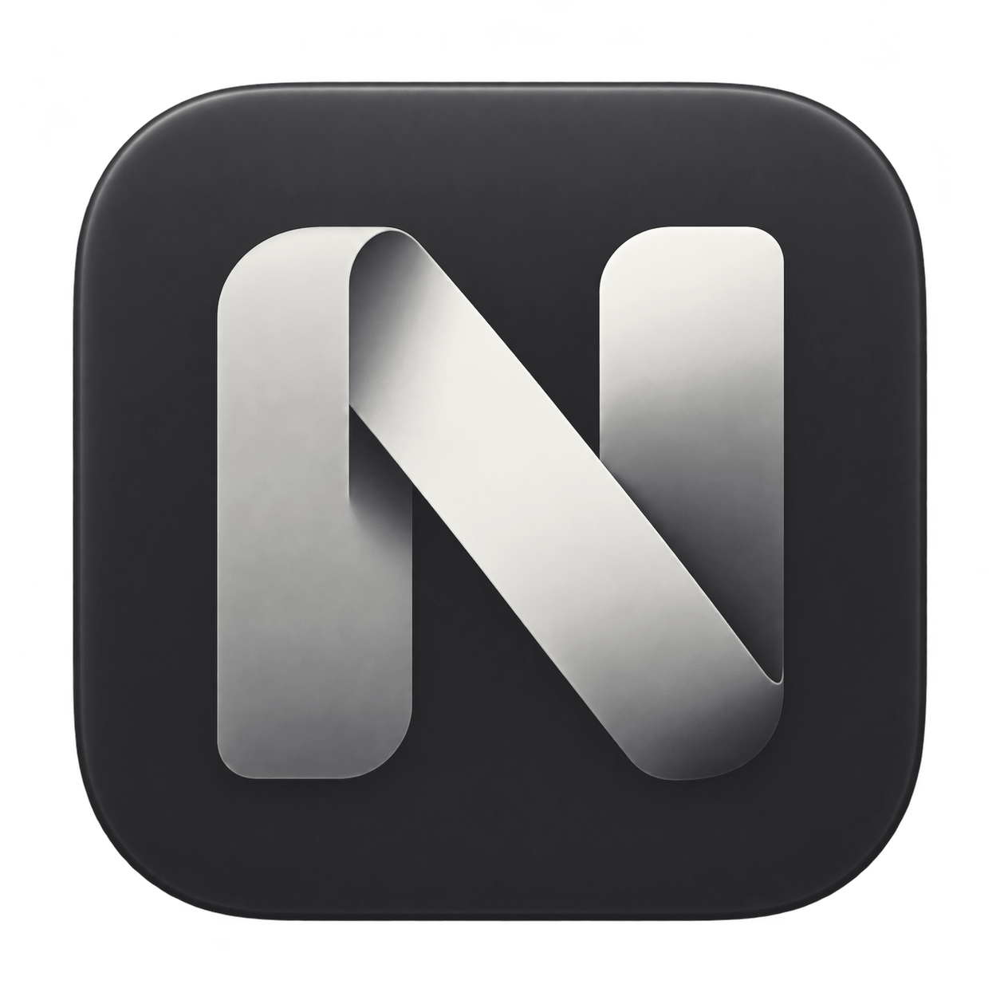

<h1 align="center">Nivlet for Mac</h1>

  <strong>The little things. Taken care of.</strong> 
  Find anything you copied, capture and annotate the screen, translate on device, snap windows into place, open apps with a keystroke and send every link to the right browser — all from the menu bar.

  <a href="https://github.com/wivnelo/Nivlet/releases/latest"><strong>Download</strong></a> ·
  <a href="https://wivnelo.github.io/Nivlet/">Website</a> ·
  <a href="documentation/USAGE.en.md">User guide</a> ·
  <a href="README.zh-CN.md">简体中文</a>

  Free and open source · macOS 13.0+ · Apple Silicon · Developer ID signed and notarized

 

  <a href="docs/assets/demos/overview-en.gif">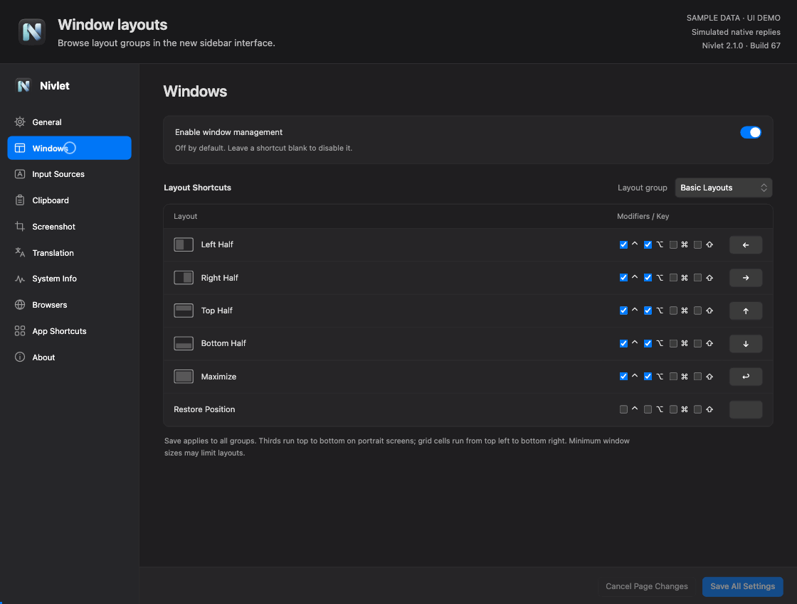</a> 
  Settings UI demo with synthetic data and simulated native responses.

## Features

| | |
| --- | --- |
| **Clipboard history** | Text and images with search, thumbnails, previews and Option-click paste. Pin images to the desktop. Set retention, exclude apps or turn recording off. |
| **Screenshot** | Freeze the screen, select an area or window, annotate with shapes, arrows, pen, text and mosaic, then copy, save or pin it. Recognize text (OCR) and QR codes on device. |
| **System translation** | Double-tap a modifier key to translate selected text or a screen area with macOS's built-in on-device translation. Automatic direction that remembers your choice (macOS 15+). |
| **Window management** | 29 actions: halves, quarters, thirds, a 3×3 grid, centering, display moves and restore. |
| **App shortcuts** | Open or bring forward apps with your own shortcuts, with conflict checks. |
| **Browser routing** | Pick a browser by source app or website, with a fallback for everything else. |
| **System & input** | Network speed in the menu bar; CPU, memory, disk and addresses in its menu. Switch input sources per app. |
| **And more** | Optional Keep Awake, four languages, light and dark appearance, JSON settings import and export. |

Turn on only what you need. No coding and no separate Hammerspoon installation required.

## Get started

1. Download the DMG or ZIP from [Releases](https://github.com/wivnelo/Nivlet/releases/latest) and move `Nivlet.app` to Applications.
2. Open it, click the **N** in the menu bar and choose **Settings…**.
3. Turn on the tools you need and click **Save All Settings**.

Window actions, Option-paste and selection translation need **Accessibility** permission; screenshots need **Screen Recording** permission. Browser routing needs Nivlet set as the **default browser**. Never disable Gatekeeper; if macOS reports malware or damage, stop and report the exact message. See the [installation and upgrade guide](documentation/INSTALLATION.en.md).

## Privacy

No account. Settings, clipboard history, screenshots, text recognition, translation and system information are processed on your Mac and never uploaded; core tools work offline. Clipboard history is cleared on quit by default. Optional persistence uses a **local plaintext cache**, so turn recording off before copying sensitive content. The app goes online only to check for updates or open links.

## Requirements

macOS 13.0 or later on Apple Silicon. Every release is Developer ID signed and notarized by Apple; updates install only after you confirm in **About → Check for Updates**. The current version is recorded in [BASELINE](BASELINE.md) and each version's changes in the [release notes](documentation/README.md).

[v1.0.8 / Build 55](https://github.com/wivnelo/Nivlet/releases/tag/v1.0.8) is the final Intel release and remains available.

## Screenshots

Show all 10 screenshots

 

Rendered from the settings frontend with synthetic data. They illustrate the interface, not a native end-to-end test.

<table>
<tr>
<td width="50%"><strong>Window management</strong> <a href="docs/assets/screenshots/en/windows.jpg">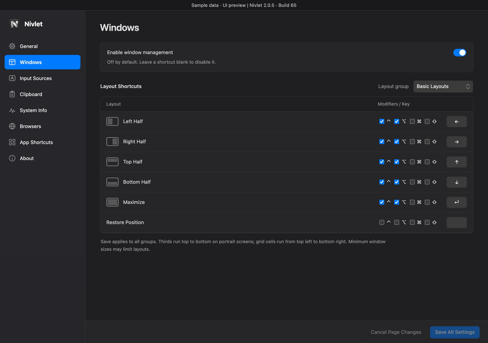</a></td>
<td width="50%"><strong>Clipboard history</strong> <a href="docs/assets/screenshots/en/clipboard.jpg">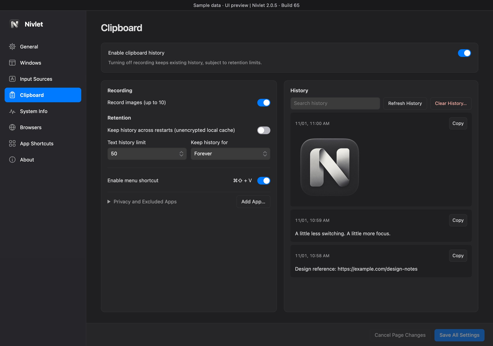</a></td>
</tr>
<tr>
<td><strong>Screenshot</strong> <a href="docs/assets/screenshots/en/capture.jpg">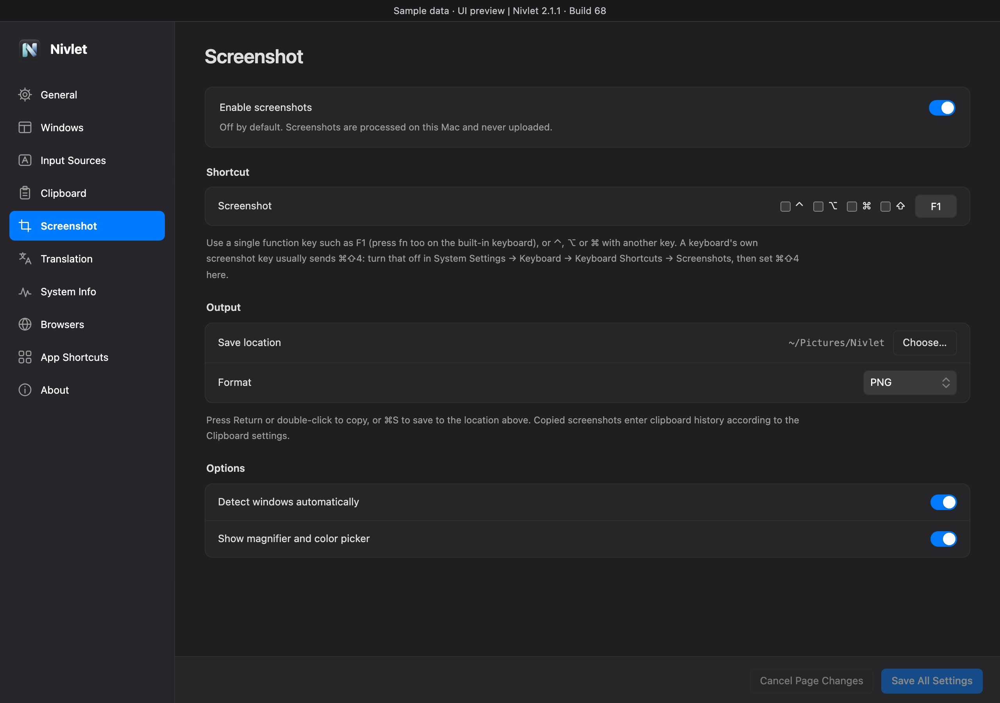</a></td>
<td><strong>System translation</strong> <a href="docs/assets/screenshots/en/translate.jpg">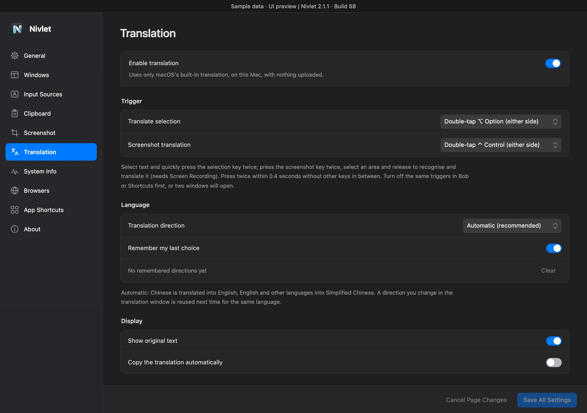</a></td>
</tr>
<tr>
<td><strong>General</strong> <a href="docs/assets/screenshots/en/general.jpg">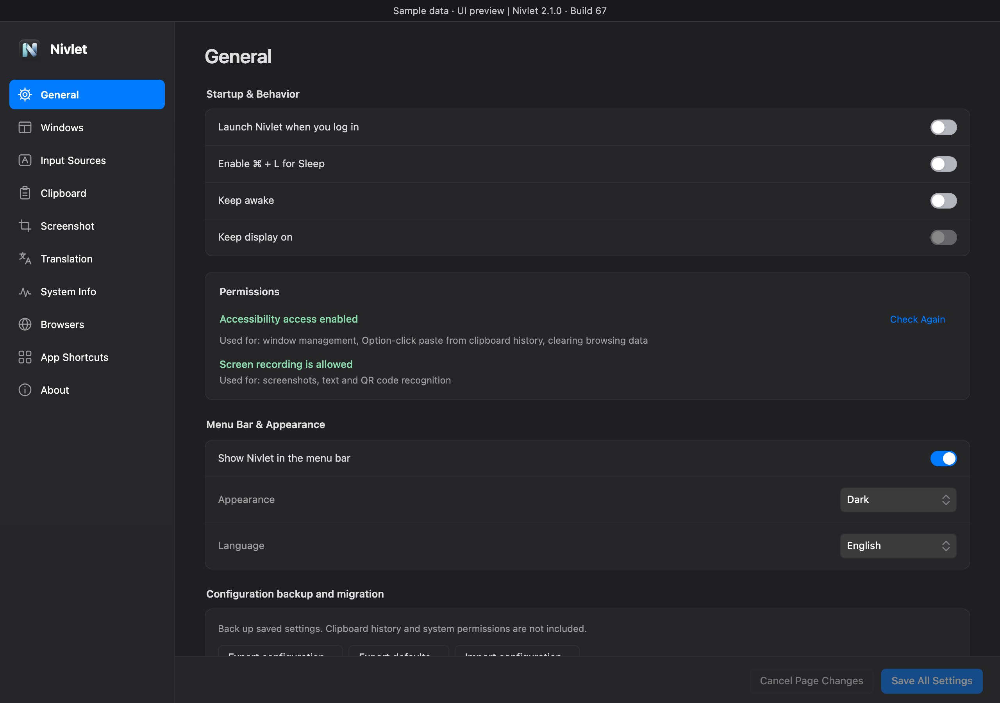</a></td>
<td><strong>Input sources</strong> <a href="docs/assets/screenshots/en/input.jpg">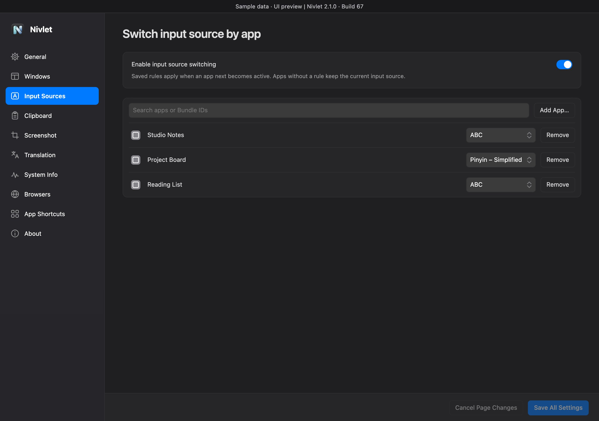</a></td>
</tr>
<tr>
<td><strong>Browser routing</strong> <a href="docs/assets/screenshots/en/browser.jpg">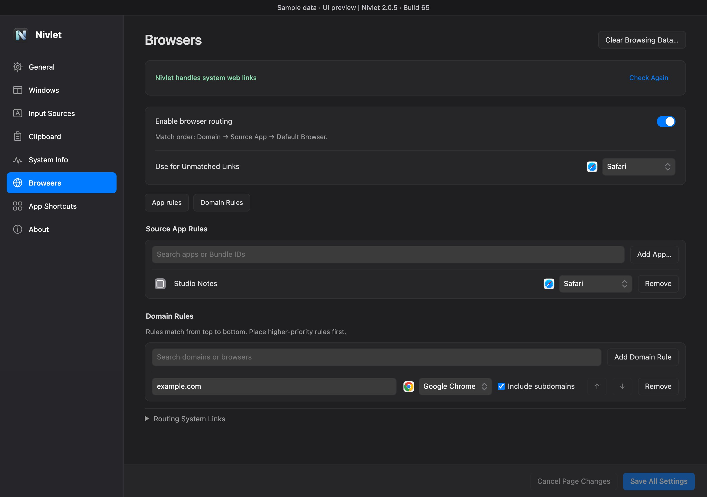</a></td>
<td><strong>App shortcuts</strong> <a href="docs/assets/screenshots/en/launcher.jpg">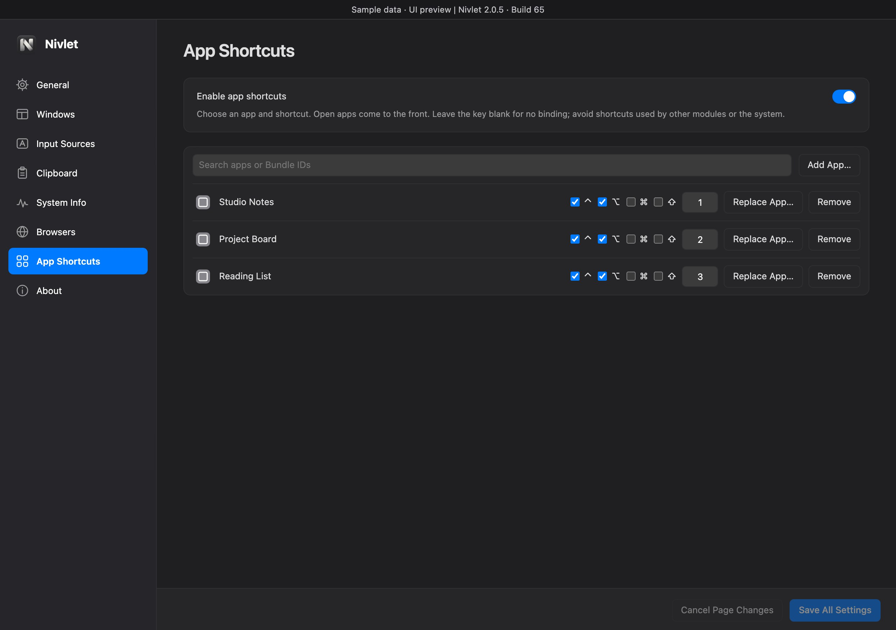</a></td>
</tr>
<tr>
<td><strong>System information</strong> <a href="docs/assets/screenshots/en/system.jpg">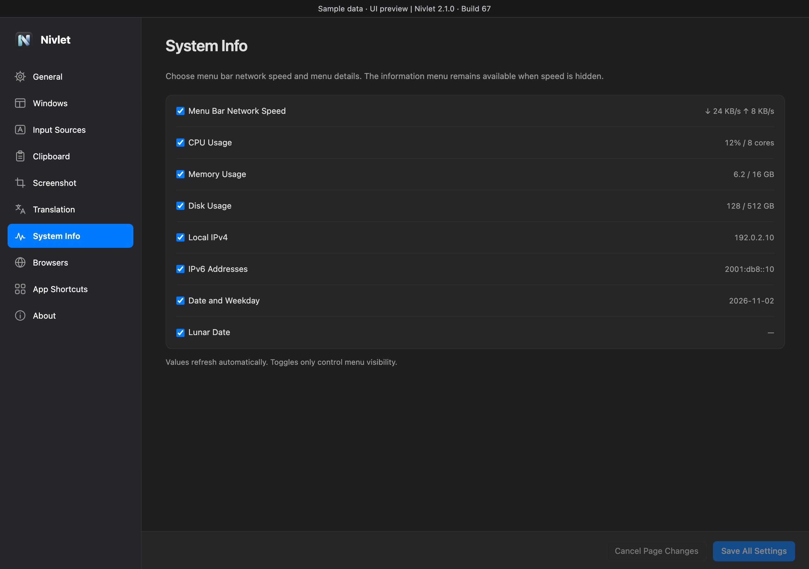</a></td>
<td><strong>About &amp; updates</strong> <a href="docs/assets/screenshots/en/about.jpg">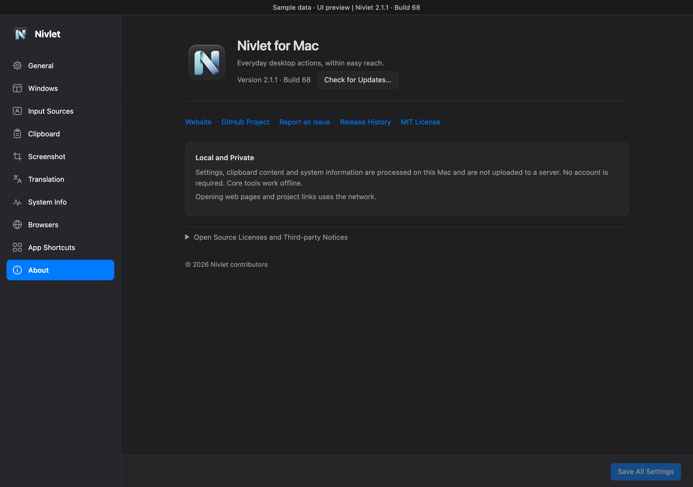</a></td>
</tr>
</table>

## More

- [User guide](documentation/USAGE.en.md) · [Configuration import/export](documentation/CONFIGURATION.md) (Chinese)
- [Roadmap](ROADMAP.md) (Chinese) · [Development and building](documentation/DEVELOPMENT.md) (Chinese)
- Report problems in [Issues](https://github.com/wivnelo/Nivlet/issues) with the app version, macOS version and steps. Don't upload sensitive clipboard contents, personal configurations or credentials.

## License

[MIT License](LICENSE). The embedded runtime is based on [Hammerspoon](https://github.com/Hammerspoon/hammerspoon); third-party components keep their own licenses — see [third-party notices](THIRD-PARTY-NOTICES.md).
