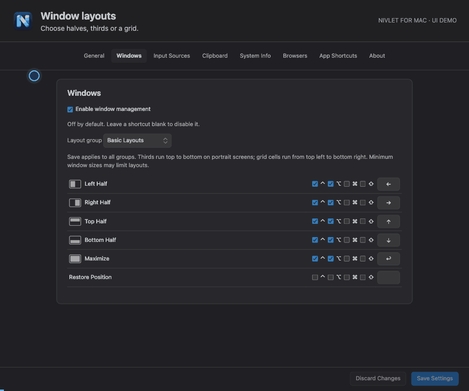
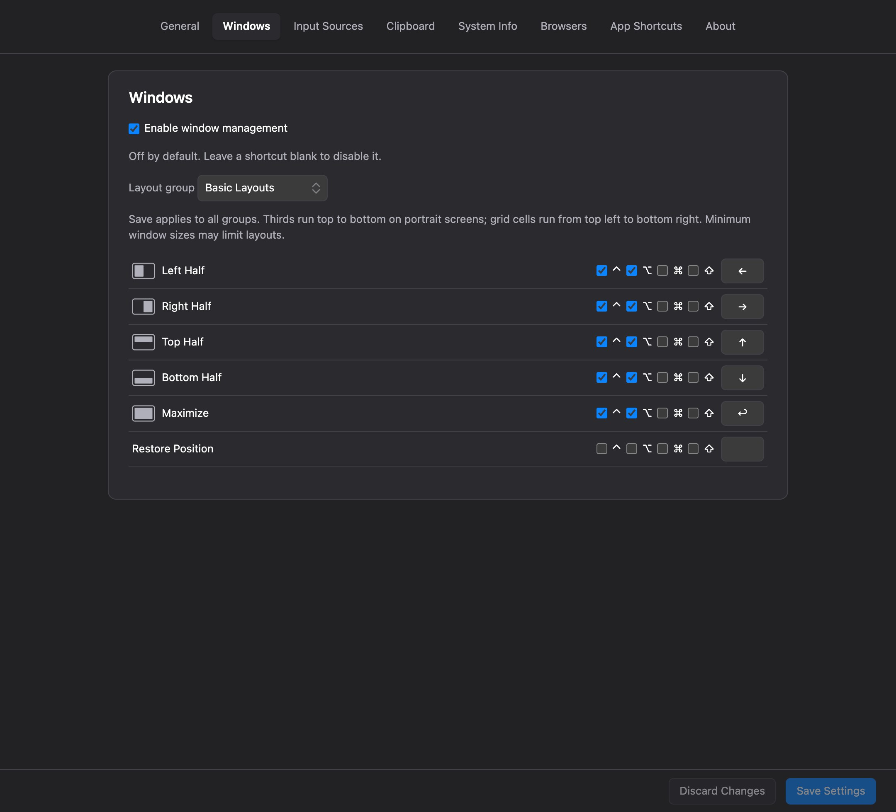
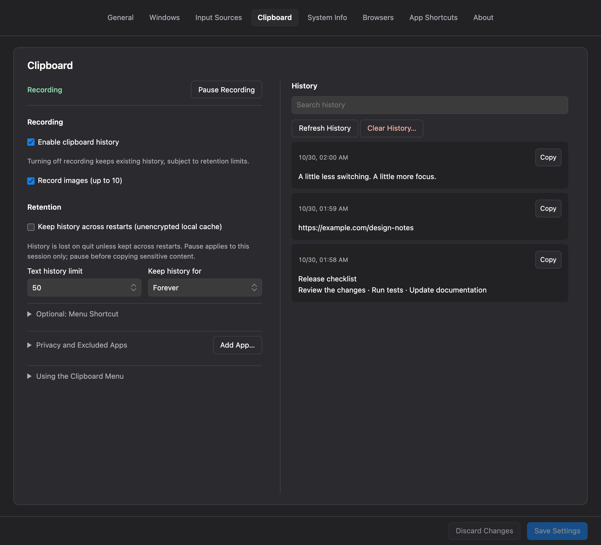
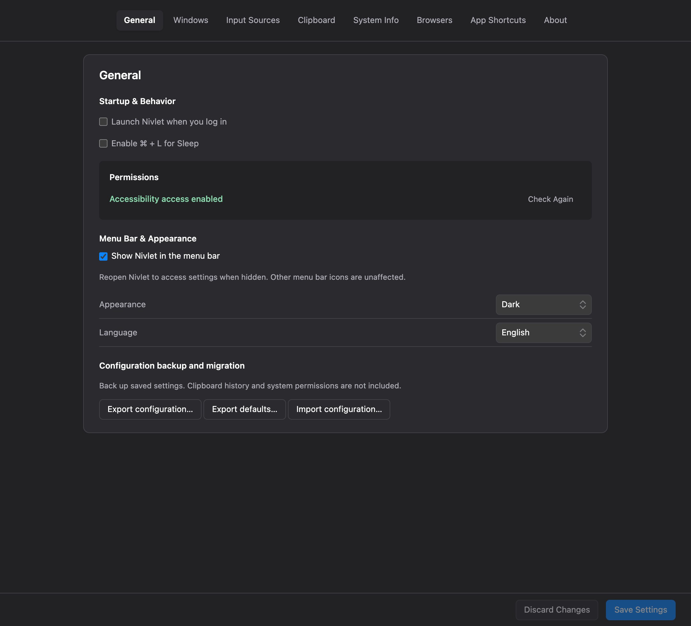
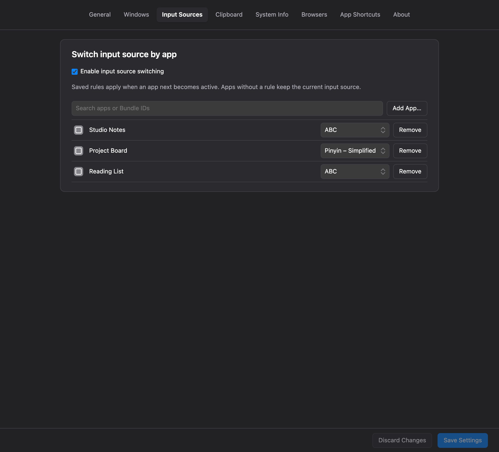
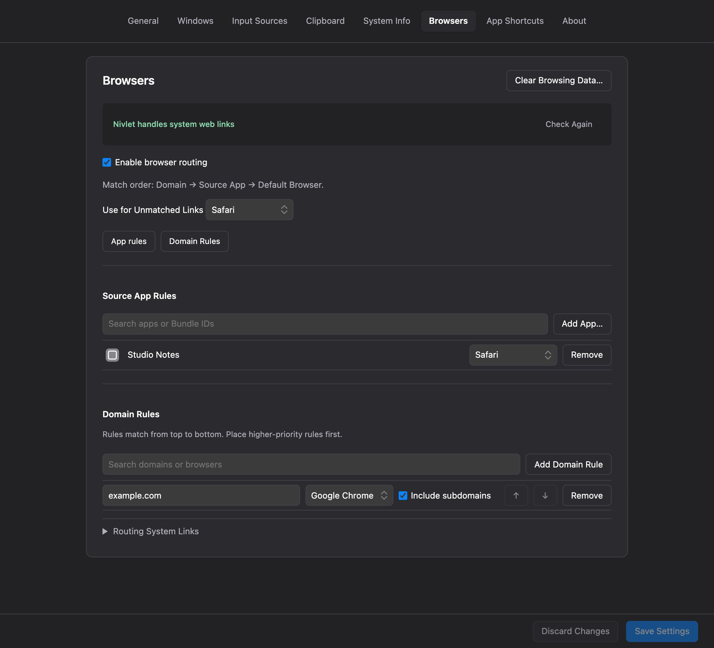
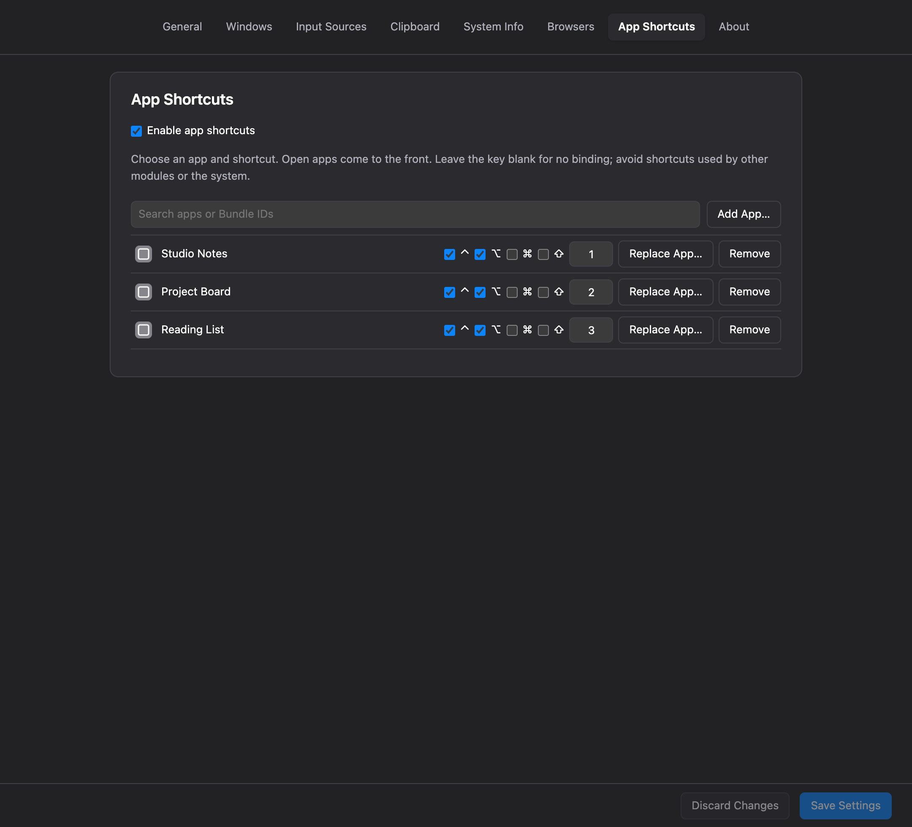
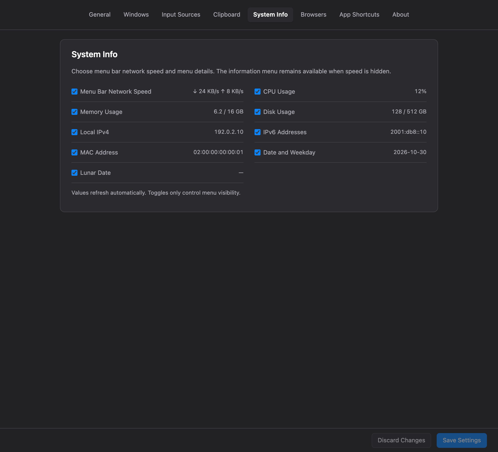
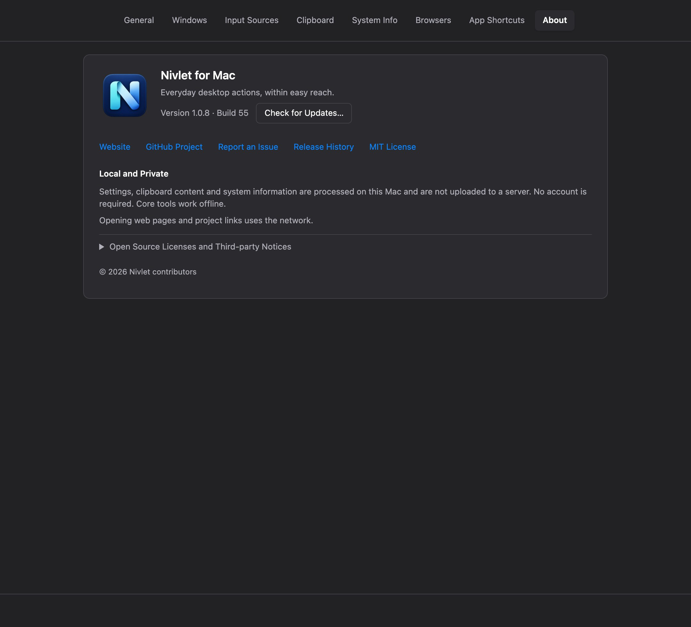

  

<h1 align="center">Nivlet for Mac</h1>

  <strong>Make everyday desktop tasks feel easier.</strong> 
  Clipboard history, window management, app shortcuts and browser routing in your Mac menu bar.

  <a href="README.zh-CN.md">简体中文</a> · <strong>English</strong>

  <a href="https://wivnelo.github.io/Nivlet/">Website</a> ·
  <a href="https://github.com/wivnelo/Nivlet/releases/latest">Download</a> ·
  <a href="documentation/USAGE.en.md">User guide</a> ·
  <a href="https://github.com/wivnelo/Nivlet/issues">Report an issue</a>

---

Nivlet is a free, open-source macOS menu bar utility that brings everyday desktop actions together. Enable the tools you need and choose your own shortcuts. No coding or separate Hammerspoon installation required.

## See it in action

  

  16-second UI demo · Synthetic data · No sound 
  <a href="docs/assets/demos/overview-en.gif">View full size</a> · <a href="#screenshots">Still screenshots</a>

## Screenshots

View all 8 screenshots

English interface, rendered from the settings UI with synthetic demonstration data. Clipboard text, network addresses, app rules, shortcuts and permission states are examples, not default settings or live system readings. Click an image to enlarge it.

<table>
<tr>
<td width="50%" valign="top"><strong>Window management</strong> </td>
<td width="50%" valign="top"><strong>Clipboard history</strong> </td>
</tr>
</table>

<table>
<tr>
<td width="50%" valign="top"><strong>General settings</strong> </td>
<td width="50%" valign="top"><strong>Input sources</strong> </td>
</tr>
<tr>
<td width="50%" valign="top"><strong>Browser routing</strong> </td>
<td width="50%" valign="top"><strong>App shortcuts</strong> </td>
</tr>
<tr>
<td width="50%" valign="top"><strong>System information</strong> </td>
<td width="50%" valign="top"><strong>About & updates</strong> </td>
</tr>
</table>

[Browse all English screenshots](docs/assets/screenshots/en/)

## What you can do

| Feature | Highlights |
| --- | --- |
| **Clipboard history** | Keep text and images with search, thumbnails, larger previews and Option-click paste; pause recording, exclude apps and choose retention limits |
| **Window management** | 29 actions for halves, quarters, thirds, a 3×3 grid, centering, resizing, display moves and restore |
| **App shortcuts** | Launch apps or bring them forward; replace apps, drag to reorder and check shortcut conflicts |
| **Browser routing** | Choose the browser for a link based on its domain or source app |
| **Input sources** | Assign an input source to an app and switch automatically when you activate it |
| **System information** | See network speed in the menu bar and choose CPU, memory, disk, network addresses and dates to display |
| **Personalization & migration** | Chinese and English, light and dark appearances, tab ordering and JSON configuration import/export |

## Get started

1. Download **either the DMG or ZIP** from [GitHub Releases](https://github.com/wivnelo/Nivlet/releases/latest).
2. Move `Nivlet.app` to Applications and open it.
3. Click the menu bar **N icon → Settings…**, enable your tools and configure their rules.
4. Click **Save Settings** in the bottom-right corner. Switching tabs keeps drafts; a small orange dot below a tab marks unsaved pages.

Features are opt-in, and shortcuts are yours to configure. Window management and Option-click paste require **Accessibility permission**. Browser routing requires choosing **Nivlet as your default browser**.

## Signed and notarized for macOS

**v1.0.8 / Build 54 uses Apple Developer ID signing and has passed Apple notarization.** Both Apple Silicon (arm64) and Intel (x86_64) apps and DMGs include stapled notarization tickets. macOS 13.0+ is required.

Download the matching DMG or ZIP from [GitHub Releases](https://github.com/wivnelo/Nivlet/releases/tag/v1.0.8), move `Nivlet.app` to Applications and launch that copy. No separate Hammerspoon installation is needed.

Signing and notarization do not replace **Accessibility permission**. Moving from an older ad-hoc build may require reauthorization; subsequent updates with the same developer identity generally retain it, subject to macOS behavior. Return to General or click **Recheck** after granting access. Do not disable Gatekeeper. If macOS reports malware, damage or a checksum mismatch, stop and report the exact message.

See the [installation, upgrade and removal guide](documentation/INSTALLATION.en.md). About → Check for Updates remains manual; confirm before installation.

## Local processing, optional recording

No account required. Settings, clipboard contents and system information are processed locally without being uploaded to a server. Core desktop tools work offline; opening websites and external links uses the network.

Clipboard history is cleared on exit by default. Optional persistence uses a **local plaintext cache**; pause recording before copying sensitive content. Clearing history also clears the current system clipboard, with a confirmation prompt.

Check for signed updates in About, then confirm to download, install and restart. Checking for updates uses the network.

## Learn more

- [User guide](documentation/USAGE.en.md) · [Configuration import/export](documentation/CONFIGURATION.md) (Chinese)
- [Releases](https://github.com/wivnelo/Nivlet/releases) · [Roadmap](ROADMAP.md) (Chinese)
- [Development & building](documentation/DEVELOPMENT.md) (Chinese)

Report problems or suggestions through [GitHub Issues](https://github.com/wivnelo/Nivlet/issues). Include the app version, macOS version and reproduction steps. Do not upload sensitive clipboard contents, personal configurations or credentials.

## License & acknowledgements

Nivlet uses the [MIT License](LICENSE). Its embedded Runtime is based on [Hammerspoon](https://github.com/Hammerspoon/hammerspoon). Third-party components retain their own licenses; see [third-party notices](THIRD-PARTY-NOTICES.md).

1.0.8 fixes rule saving for apps with dotless Bundle IDs, including FinalShell, and retains Developer ID signing and Apple notarization. See [release notes](documentation/RELEASE-v1.0.8.md).
