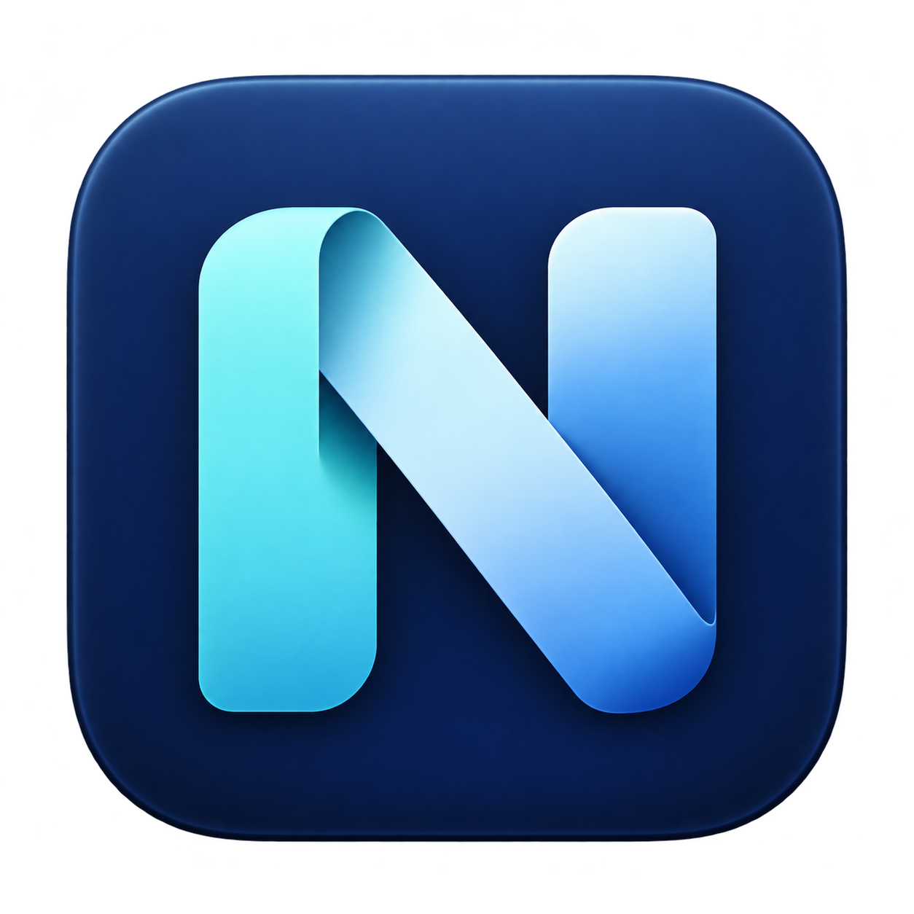
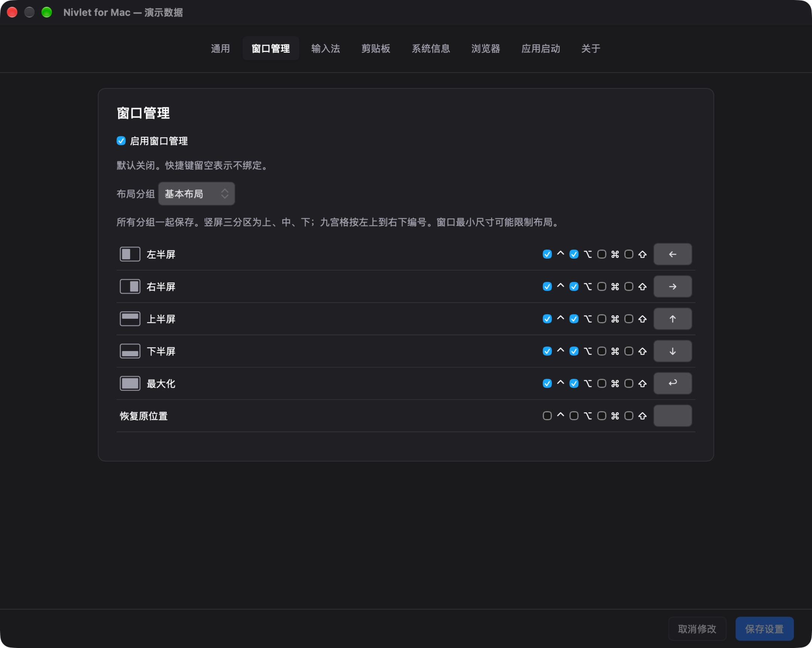
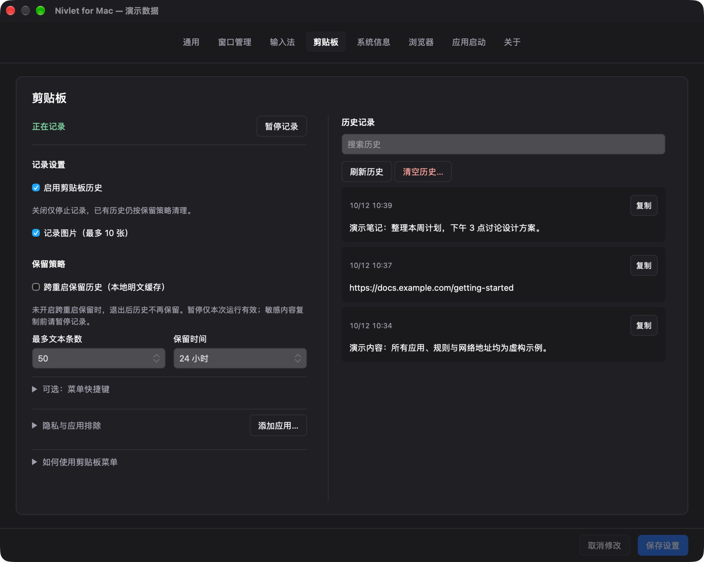
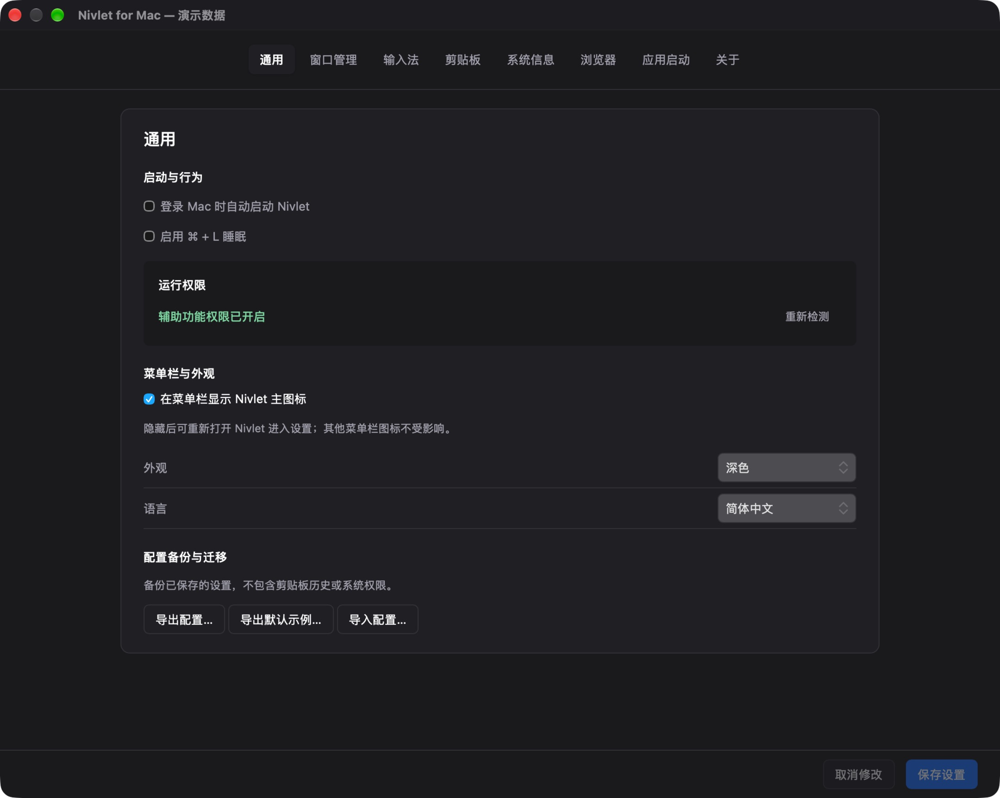
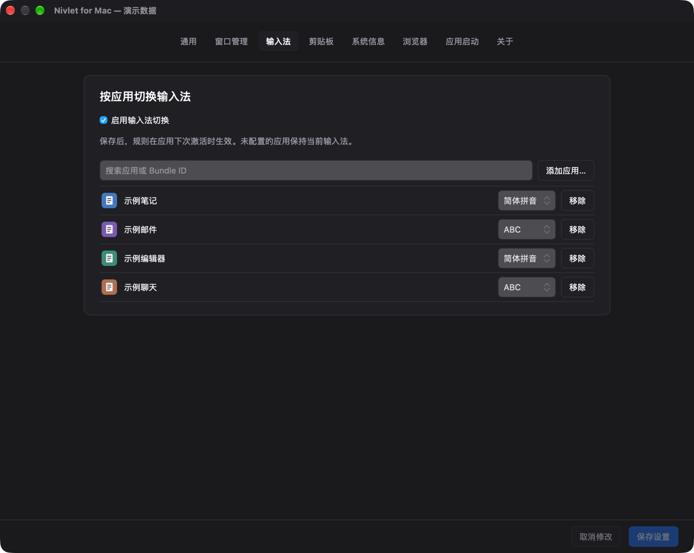
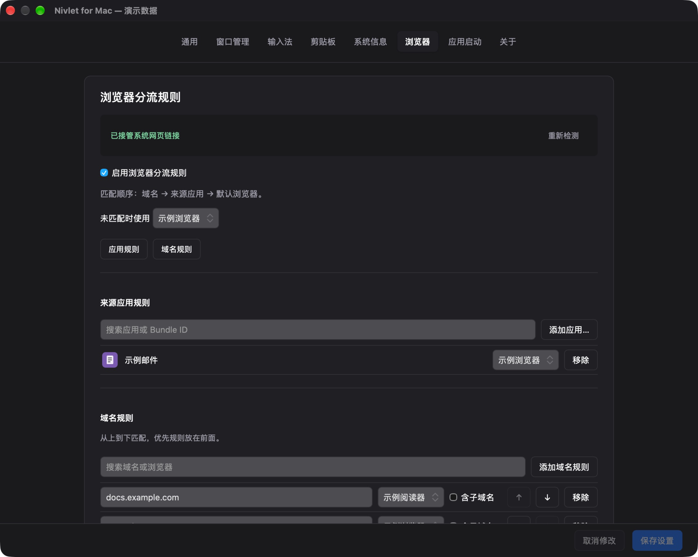
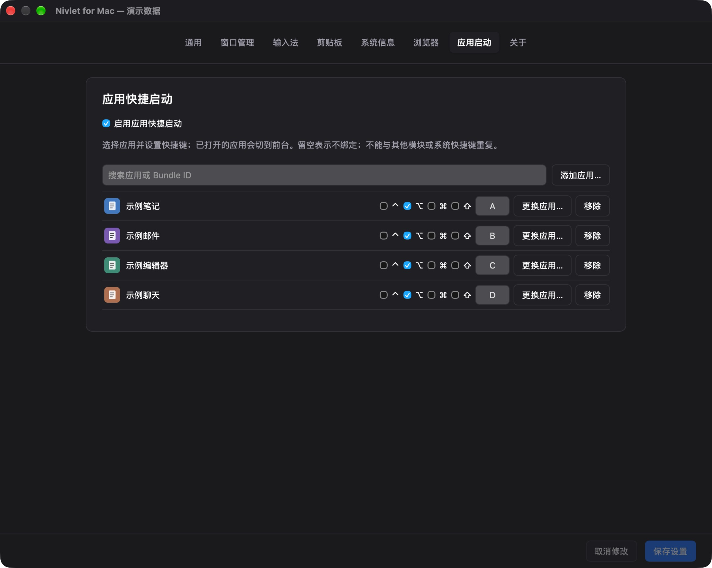
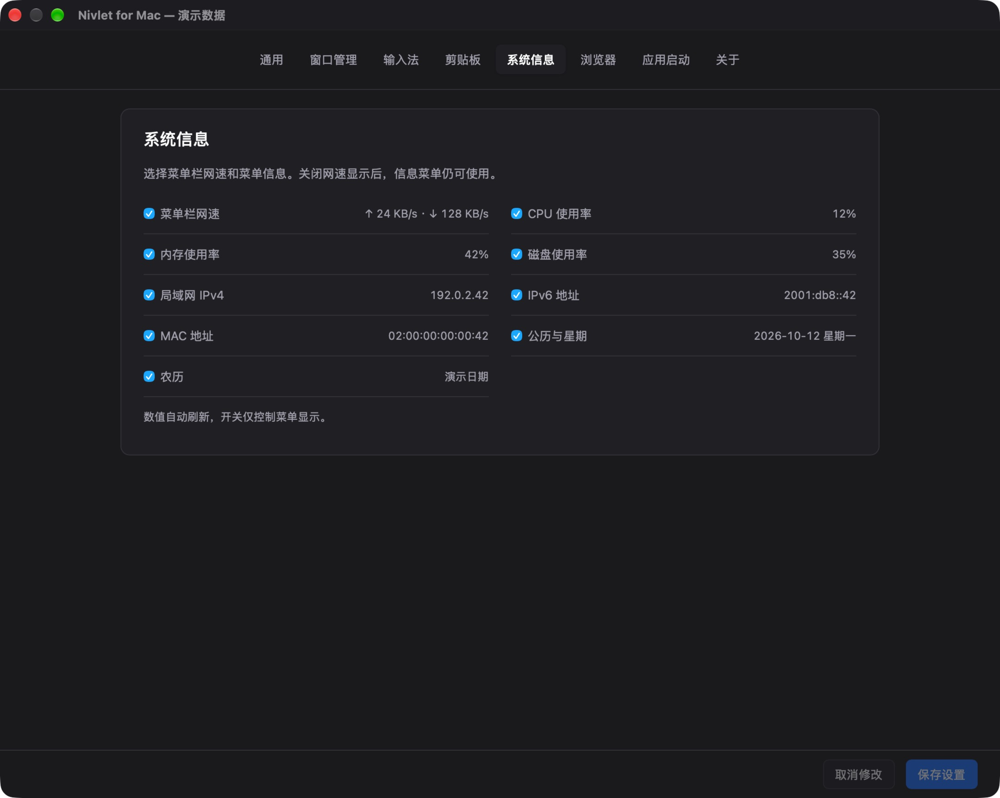
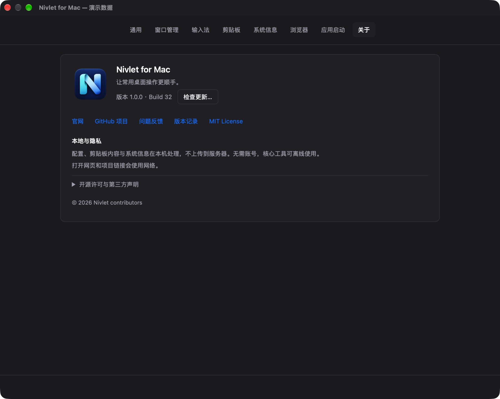

  

<h1 align="center">Nivlet for Mac</h1>

  <strong>Make everyday desktop tasks feel easier.</strong> 
  Clipboard history, window management, app shortcuts and browser routing in your Mac menu bar.

  <a href="README.zh-CN.md">简体中文</a> · <strong>English</strong>

  <a href="https://wivnelo.github.io/Nivlet/">Website</a> ·
  <a href="https://github.com/wivnelo/Nivlet/releases/latest">Download</a> ·
  <a href="documentation/USAGE.en.md">User guide</a> ·
  <a href="https://github.com/wivnelo/Nivlet/issues">Report an issue</a>

---

Nivlet is a free, open-source macOS menu bar utility that brings everyday desktop actions together. Enable the tools you need and choose your own shortcuts. No coding or separate Hammerspoon installation required.

## Screenshots

Interface reference: Browser uses 1.0.1 / Build 41; other pages retain 1.0.0 / Build 32. Chinese interface. Clipboard text, network addresses, app names/icons, rules and shortcuts are synthetic examples, not default settings. Click an image to enlarge it.

<table>
<tr>
<td width="50%" valign="top"><strong>Window management</strong> </td>
<td width="50%" valign="top"><strong>Clipboard history</strong> </td>
</tr>
</table>

View the other six pages

<table>
<tr>
<td width="50%" valign="top"><strong>General settings</strong> </td>
<td width="50%" valign="top"><strong>Input sources</strong> </td>
</tr>
<tr>
<td width="50%" valign="top"><strong>Browser routing</strong> </td>
<td width="50%" valign="top"><strong>App shortcuts</strong> </td>
</tr>
<tr>
<td width="50%" valign="top"><strong>System information</strong> </td>
<td width="50%" valign="top"><strong>About & updates</strong> </td>
</tr>
</table>

[Browse the full screenshot gallery](https://wivnelo.github.io/Nivlet/screenshots.html)

## What you can do

| Feature | Highlights |
| --- | --- |
| **Clipboard history** | Keep text and images with search, thumbnails, larger previews and Option-click paste; pause recording, exclude apps and choose retention limits |
| **Window management** | 29 actions for halves, quarters, thirds, a 3×3 grid, centering, resizing, display moves and restore |
| **App shortcuts** | Launch apps or bring them forward; replace apps, drag to reorder and check shortcut conflicts |
| **Browser routing** | Choose the browser for a link based on its domain or source app |
| **Input sources** | Assign an input source to an app and switch automatically when you activate it |
| **System information** | See network speed in the menu bar and choose CPU, memory, disk, network addresses and dates to display |
| **Personalization & migration** | Chinese and English, light and dark appearances, tab ordering and JSON configuration import/export |

## Get started

1. Download **either the DMG or ZIP** from [GitHub Releases](https://github.com/wivnelo/Nivlet/releases/latest).
2. Move `Nivlet.app` to Applications and open it.
3. Click the menu bar **N icon → Settings…**, enable your tools and configure their rules.
4. Click **Save Settings** in the bottom-right corner. Switching tabs keeps drafts; a small orange dot below a tab marks unsaved pages.

Features are opt-in, and shortcuts are yours to configure. Window management and Option-click paste require **Accessibility permission**. Browser routing requires choosing **Nivlet as your default browser**.

## Before installing: no Apple Developer ID signature yet

**v1.0.4 / Build 45 is distributed with ad-hoc signing. It has no Apple Developer ID signature or Apple notarization.** macOS may block first launch; this is separate from the signed in-app update channel.

Download only from this project's [GitHub Releases](https://github.com/wivnelo/Nivlet/releases/tag/v1.0.4). Open the DMG and drag `Nivlet.app` to **Applications**, or extract the ZIP and move the app there. Eject the DMG and launch the copy in Applications.

If macOS says the developer cannot be verified or Apple cannot check the app, and you trust the download:

1. Try opening the app once, then dismiss the warning.
2. Open **System Settings → Privacy & Security**, find the notice for Nivlet and choose **Open Anyway**.
3. Confirm **Open** and authenticate if prompted. Do not disable Gatekeeper globally.

If macOS reports malware, damage, or a checksum mismatch, stop and report the exact message rather than treating it as an ordinary developer warning. The exception may be unavailable on managed Macs. See [Apple's guidance](https://support.apple.com/en-us/102445) and the [full installation, upgrade and removal guide](documentation/INSTALLATION.en.md).

**Requirements:** macOS 13.0+, Apple Silicon (arm64) or Intel (x86_64). Old installation packages, including the historical Intel build, have been withdrawn for privacy remediation.

Ad-hoc updates may require granting Accessibility permission again; select `/Applications/Nivlet.app` in System Settings and click Check Again in General.

## Local processing, optional recording

No account required. Settings, clipboard contents and system information are processed locally without being uploaded to a server. Core desktop tools work offline; opening websites and external links uses the network.

Clipboard history is cleared on exit by default. Optional persistence uses a **local plaintext cache**; pause recording before copying sensitive content. Clearing history also clears the current system clipboard, with a confirmation prompt.

Check for signed updates in About, then confirm to download, install and restart. Checking for updates uses the network.

## Learn more

- [User guide](documentation/USAGE.en.md) · [Configuration import/export](documentation/CONFIGURATION.md) (Chinese)
- [Releases](https://github.com/wivnelo/Nivlet/releases) · [Roadmap](ROADMAP.md) (Chinese)
- [Development & building](documentation/DEVELOPMENT.md) (Chinese)

Report problems or suggestions through [GitHub Issues](https://github.com/wivnelo/Nivlet/issues). Include the app version, macOS version and reproduction steps. Do not upload sensitive clipboard contents, personal configurations or credentials.

## License & acknowledgements

Nivlet uses the [MIT License](LICENSE). Its embedded Runtime is based on [Hammerspoon](https://github.com/Hammerspoon/hammerspoon). Third-party components retain their own licenses; see [third-party notices](THIRD-PARTY-NOTICES.md).

1.0.4 adds a Safari / Chrome clear-data entry and preserves the current settings page when reopening. See [release notes](documentation/RELEASE-v1.0.4.md).
