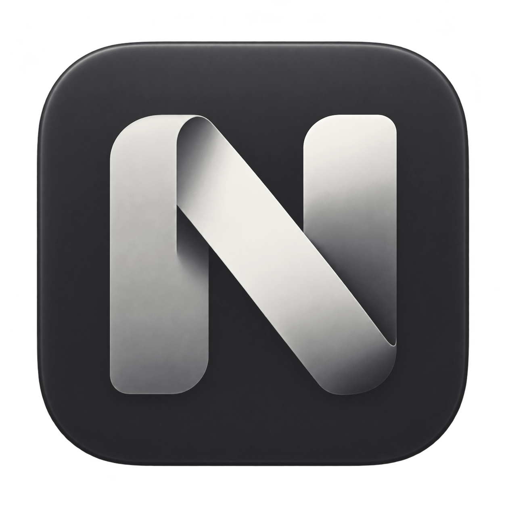
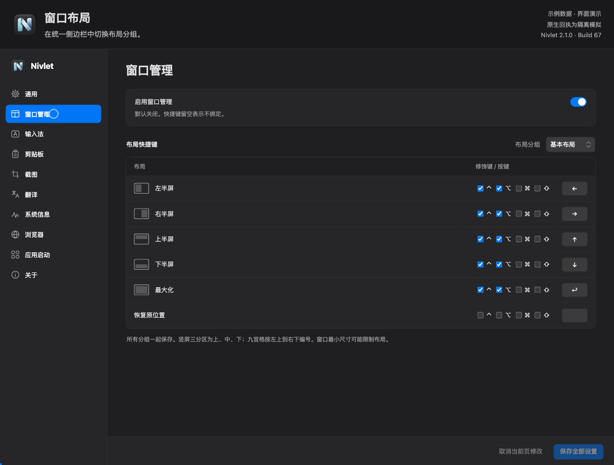
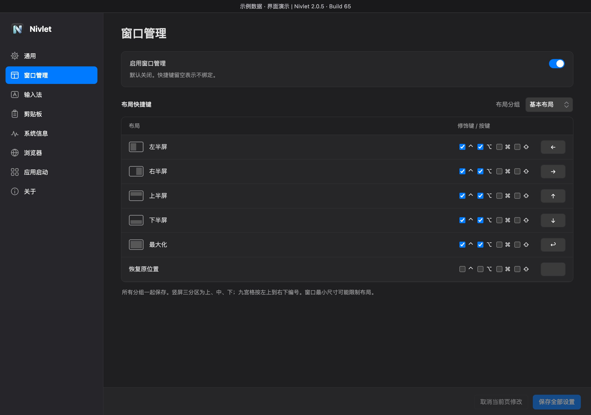
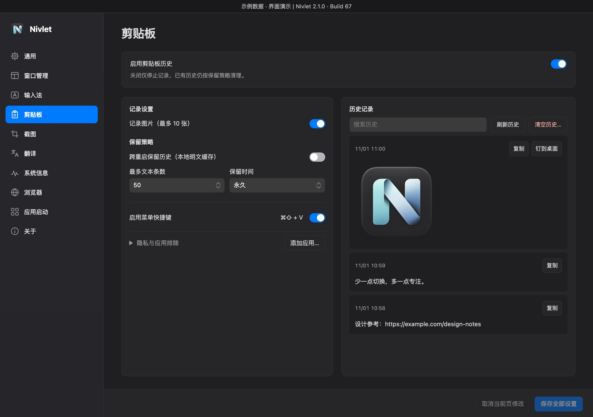
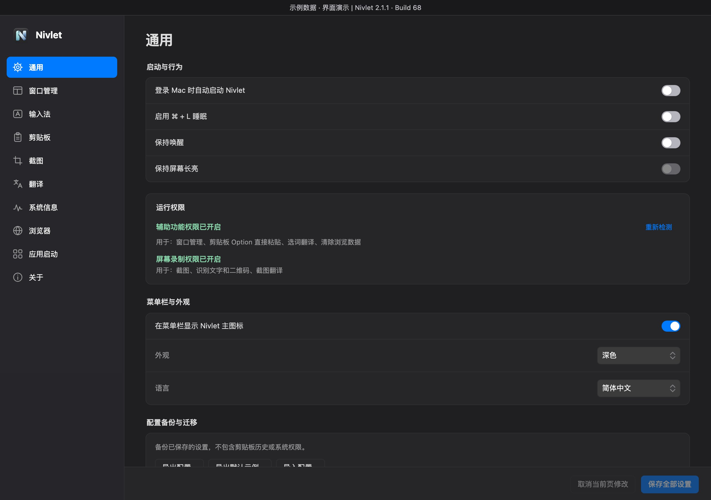
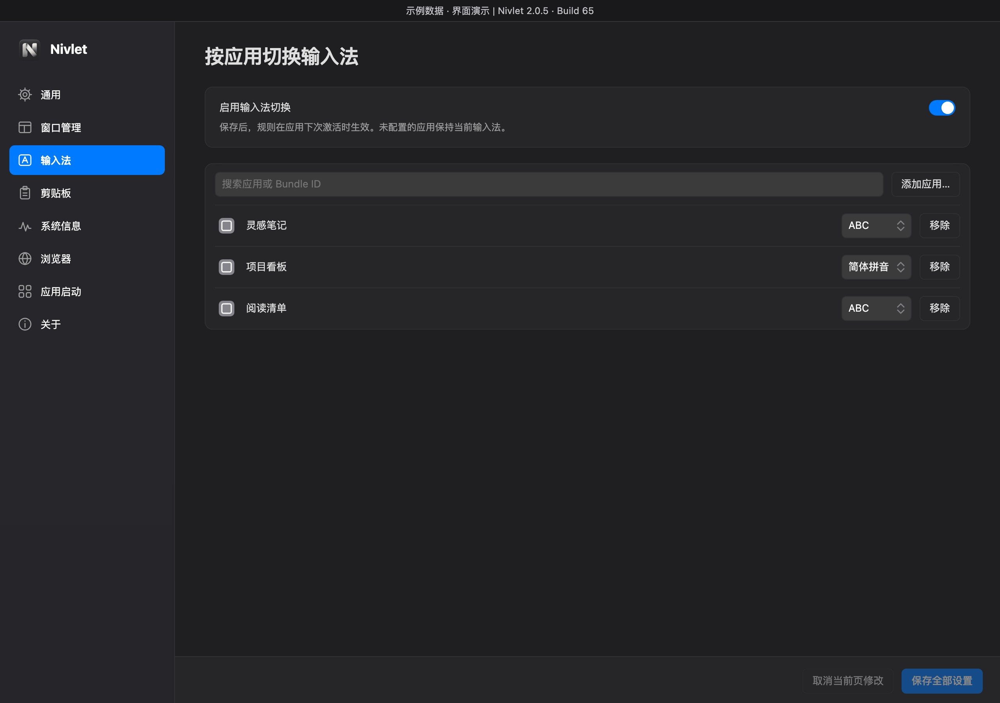
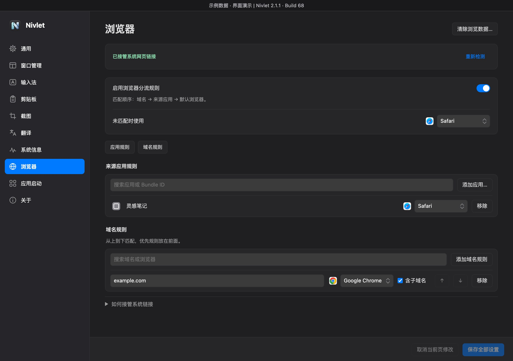
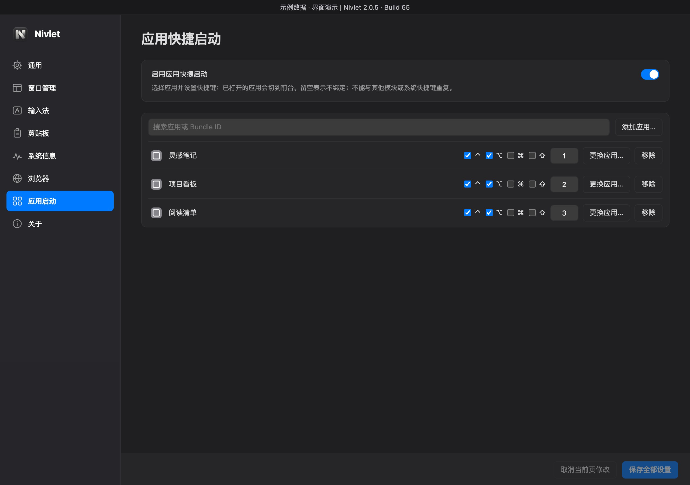
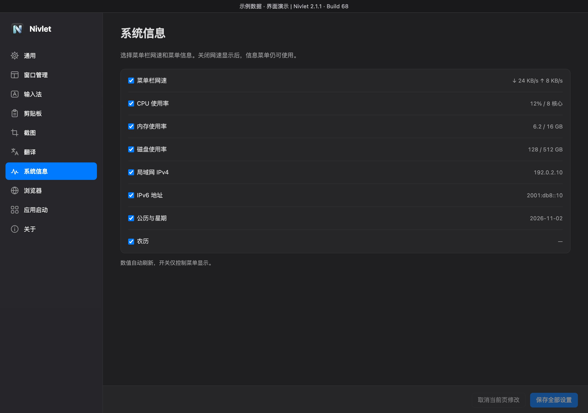
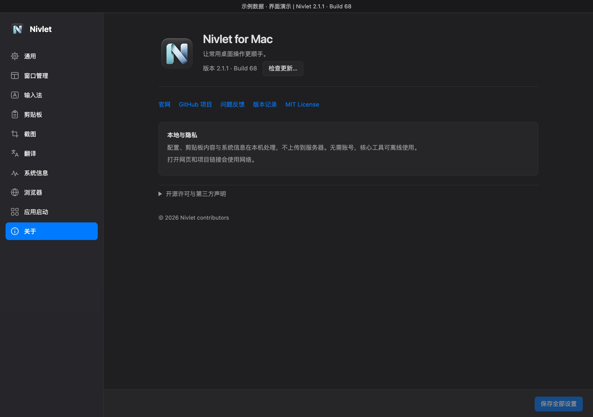

  

<h1 align="center">Nivlet for Mac</h1>

  <strong>常用的小事，交给菜单栏。</strong> 
  复制过的内容随时找回，截图标注、本机翻译随手可用，窗口一键摆好，常用应用一按就开，链接自动用对的浏览器打开。

  <a href="https://github.com/wivnelo/Nivlet/releases/latest"><strong>下载</strong></a> ·
  <a href="https://wivnelo.github.io/Nivlet/">官网</a> ·
  <a href="documentation/USAGE.md">使用指南</a> ·
  <a href="README.md">English</a>

  免费开源 · macOS 13.0+ · Apple Silicon · Developer ID 签名并经 Apple 公证

 

   
  设置界面演示，使用合成数据与模拟原生回执。

## 功能

| | |
| --- | --- |
| **剪贴板历史** | 留存文字与图片，支持搜索、缩略图、预览和 Option 点击直接粘贴，图片可钉在桌面；可设保留期限、排除应用或关闭记录。 |
| **截图** | 冻结屏幕后框选区域或窗口，用矩形、箭头、画笔、文字和马赛克标注，再复制、保存或钉在桌面；本机识别文字（OCR）和二维码。 |
| **系统翻译** | 双击修饰键翻译选中的文字或屏幕区域，只用 macOS 自带的本机翻译；自动判断方向并记住你的选择（需 macOS 15 及以上）。 |
| **窗口管理** | 29 项操作：半屏、四角、三分区、九宫格、居中、跨屏与恢复。 |
| **应用快捷启动** | 用自定义快捷键打开应用或切到前台，自动检查冲突。 |
| **浏览器分流** | 按来源应用或网站选择浏览器，未匹配的链接使用指定的默认浏览器。 |
| **系统与输入法** | 菜单栏显示网速，菜单里查看 CPU、内存、磁盘与网络地址；按应用自动切换输入法。 |
| **更多** | 可选保持唤醒、四种界面语言、深浅色外观，以及 JSON 配置导入导出。 |

功能按需开启，无需编写代码，也无需另装 Hammerspoon。

## 开始使用

1. 从 [Releases](https://github.com/wivnelo/Nivlet/releases/latest) 下载 DMG 或 ZIP，将 `Nivlet.app` 放入“应用程序”。
2. 打开应用，点击菜单栏 **N** 图标，选择 **设置…**。
3. 开启需要的功能，点击 **保存全部设置**。

窗口管理、Option 直接粘贴和选词翻译需要**辅助功能权限**，截图需要**屏幕录制权限**；浏览器分流需要将 Nivlet 设为**默认浏览器**。无需关闭 Gatekeeper；若系统提示恶意软件或应用已损坏，请停止安装并反馈原文。详见[安装、升级和卸载指南](documentation/INSTALLATION.md)。

## 隐私

无需账号。配置、剪贴板、截图、文字识别、翻译与系统信息都在本机处理，不上传服务器，核心工具可离线使用。剪贴板历史默认退出后清空；跨重启保留使用**本地明文缓存**，复制敏感内容前请先关闭记录。只有检查更新和打开链接时才会联网。

## 系统要求

macOS 13.0 及以上，Apple Silicon。正式版均使用 Developer ID 签名并通过 Apple 公证；在 **关于 → 检查更新…** 中确认后才会安装更新。当前版本见 [BASELINE](BASELINE.md)，各版本改动见[版本说明目录](documentation/README.md)。

[v1.0.8 / Build 55](https://github.com/wivnelo/Nivlet/releases/tag/v1.0.8) 是最后一个 Intel 版本，仍可下载。

## 界面预览

展开全部 8 张截图

 

截图来自设置前端与合成数据，仅示意界面，不代表原生端到端验收。

<table>
<tr>
<td width="50%"><strong>窗口管理</strong> </td>
<td width="50%"><strong>剪贴板历史</strong> </td>
</tr>
<tr>
<td><strong>通用</strong> </td>
<td><strong>输入法</strong> </td>
</tr>
<tr>
<td><strong>浏览器分流</strong> </td>
<td><strong>应用启动</strong> </td>
</tr>
<tr>
<td><strong>系统信息</strong> </td>
<td><strong>关于与更新</strong> </td>
</tr>
</table>

## 了解更多

- [使用指南](documentation/USAGE.md) · [配置导入导出](documentation/CONFIGURATION.md)
- [开发计划](ROADMAP.md) · [开发与构建](documentation/DEVELOPMENT.md)
- 遇到问题请提交 [Issue](https://github.com/wivnelo/Nivlet/issues)，附上应用版本、macOS 版本与复现步骤。请勿上传敏感剪贴板内容、私人配置或凭据。

## 许可证

[MIT License](LICENSE)。内置运行时基于 [Hammerspoon](https://github.com/Hammerspoon/hammerspoon)；第三方组件保留各自许可证，见[第三方声明](THIRD-PARTY-NOTICES.md)。
