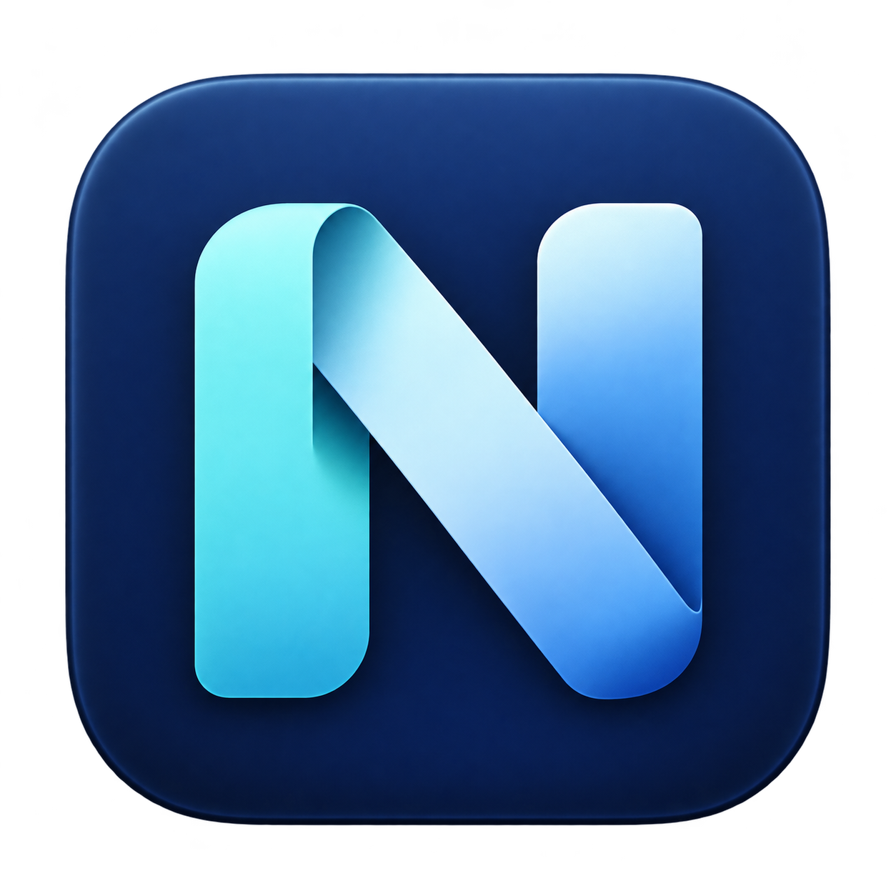
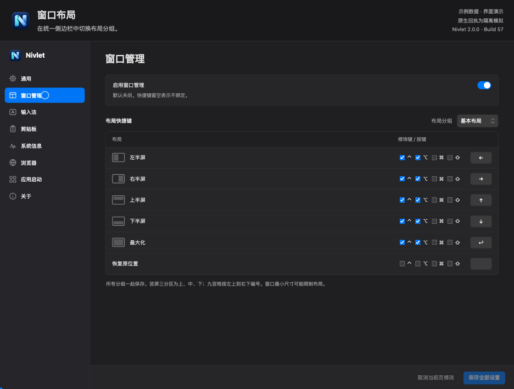
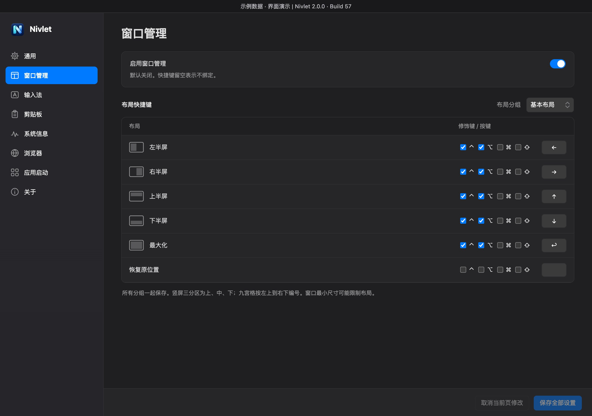
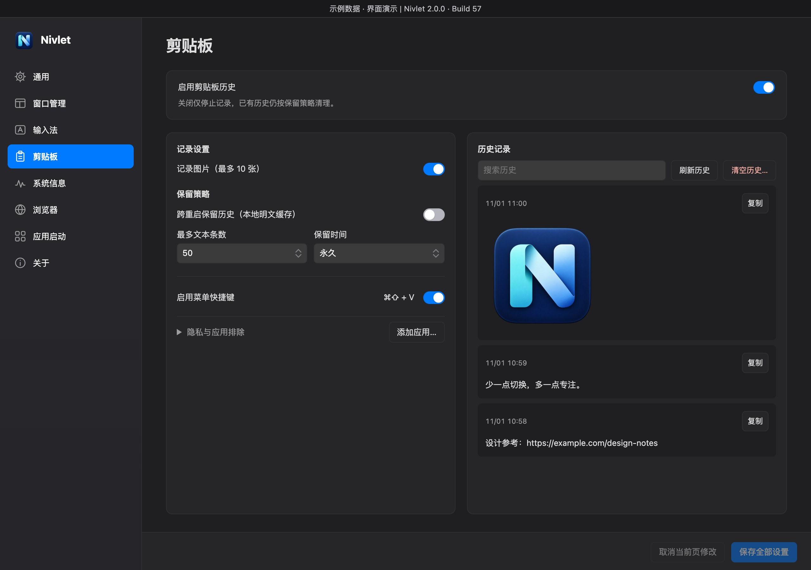
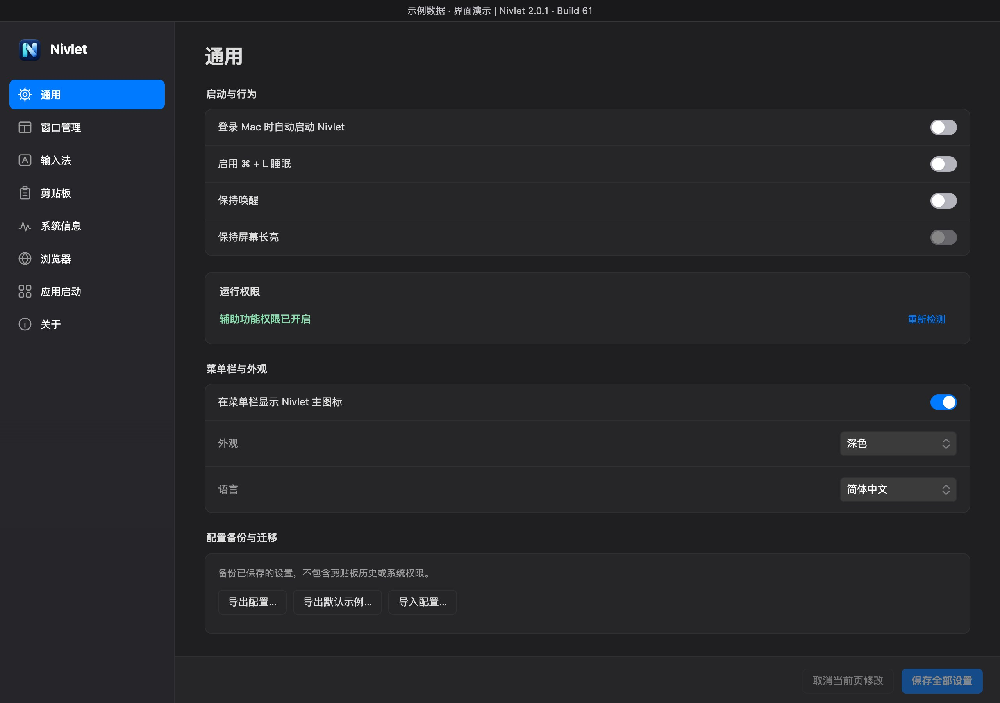
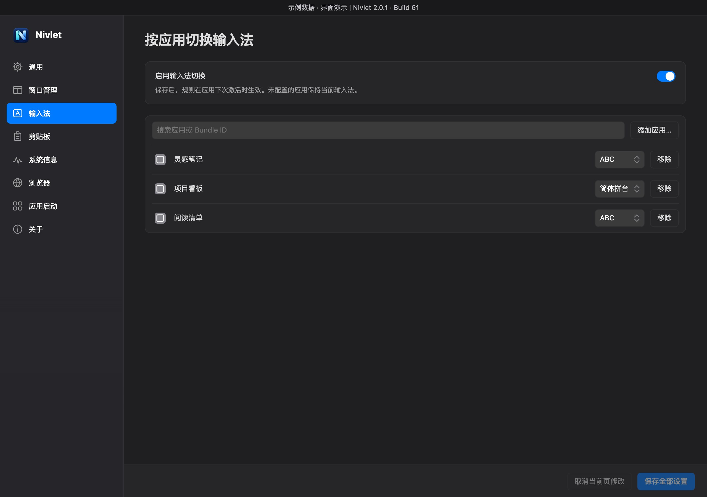
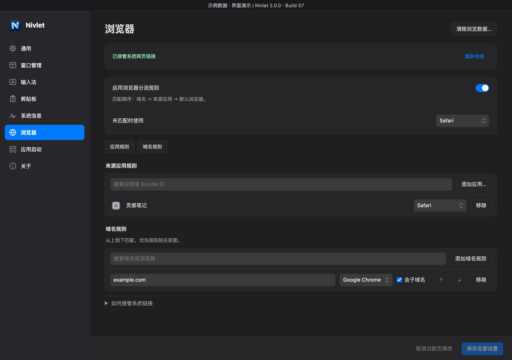
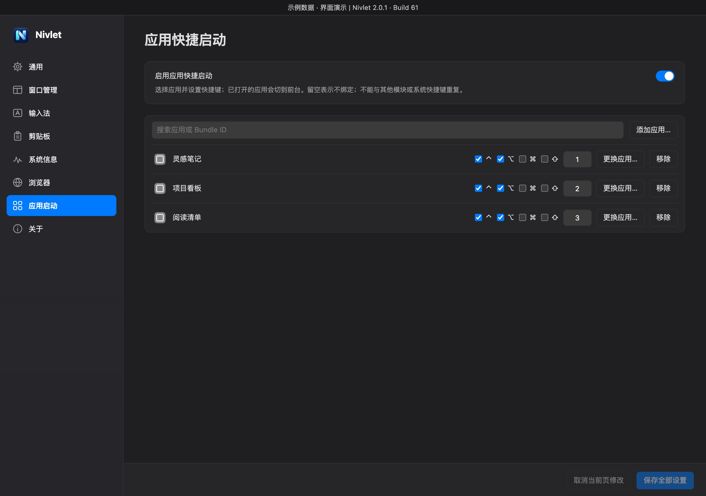
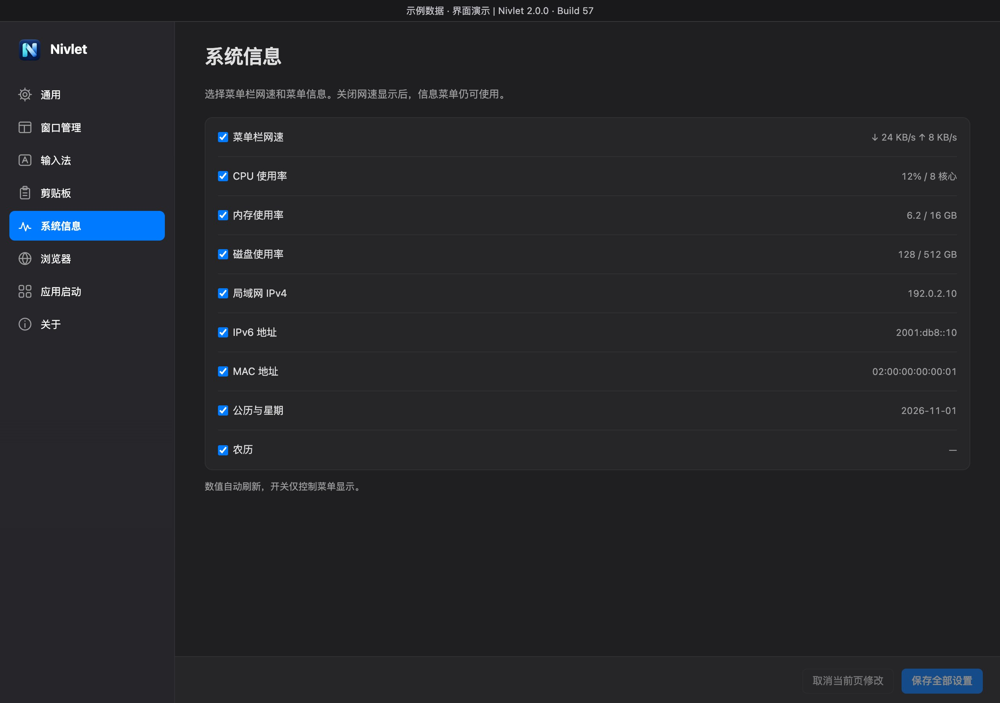
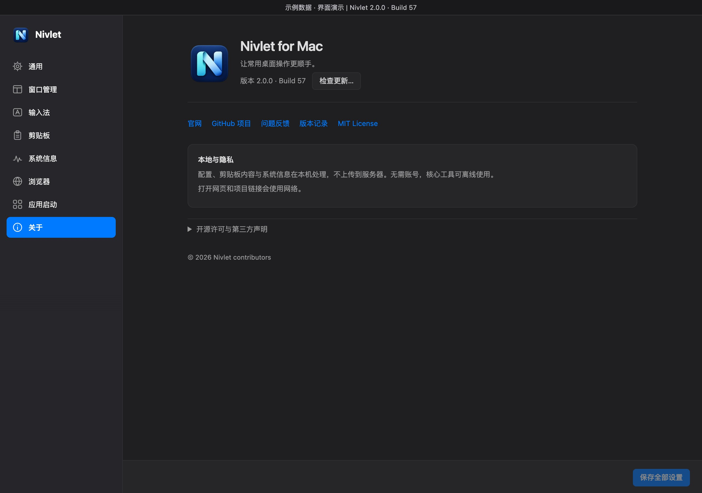

  

<h1 align="center">Nivlet for Mac</h1>

  <strong>让常用桌面操作更顺手。</strong> 
  剪贴板、窗口管理、应用快捷启动与浏览器分流，集中在 Mac 菜单栏。

  <strong>简体中文</strong> · <a href="README.md">English</a>

  <a href="https://wivnelo.github.io/Nivlet/">官网</a> ·
  <a href="https://github.com/wivnelo/Nivlet/releases/latest">下载安装</a> ·
  <a href="documentation/USAGE.md">使用指南</a> ·
  <a href="https://github.com/wivnelo/Nivlet/issues">问题反馈</a>

---

Nivlet 是一款免费开源的 macOS 菜单栏工具，将常用操作放在一处。按需启用功能、配置自己的快捷键，无需编写代码，也无需另外安装 Hammerspoon。

## 动态演示

  

  28 秒设置界面演示 · 合成数据与模拟原生回执 · 无声循环 
  <a href="docs/assets/demos/overview-zh.gif">查看原尺寸</a> · <a href="#界面预览">静态截图</a>

## 界面预览

展开查看全部 8 张截图

截图与演示展示 2.0.1 / Build 61 设置界面（产品源码 `9ddcbf9`），在隔离环境中配合合成数据与模拟原生回执生成，用于展示界面，不是原生端到端测试录像。剪贴板文字、网络地址、软件名称、规则、快捷键及权限状态均为示例，不代表默认配置或实际系统读数。浏览器图标采用应用公开图标资源。点击图片可查看大图。

<table>
<tr>
<td width="50%" valign="top"><strong>窗口管理</strong> </td>
<td width="50%" valign="top"><strong>剪贴板历史</strong> </td>
</tr>
</table>

<table>
<tr>
<td width="50%" valign="top"><strong>通用设置</strong> </td>
<td width="50%" valign="top"><strong>输入法切换</strong> </td>
</tr>
<tr>
<td width="50%" valign="top"><strong>浏览器分流</strong> </td>
<td width="50%" valign="top"><strong>应用快捷启动</strong> </td>
</tr>
<tr>
<td width="50%" valign="top"><strong>系统信息</strong> </td>
<td width="50%" valign="top"><strong>关于与更新</strong> </td>
</tr>
</table>

[浏览完整截图画廊](https://wivnelo.github.io/Nivlet/screenshots.html)

## 能做什么

| 功能 | 用法与亮点 |
| --- | --- |
| **剪贴板历史** | 留存文字与图片，支持搜索、缩略图、放大预览和 Option 直接粘贴；可开启或关闭记录、排除应用与设置保留期限 |
| **窗口管理** | 29 项操作，覆盖半屏、四角、三分区、九宫格、居中、缩放、跨屏与恢复 |
| **应用快捷启动** | 自定义快捷键，启动应用或切到前台；支持更换应用、拖动排序与冲突检查 |
| **保持唤醒** | 可选防止闲置休眠及依赖它的屏幕长亮开关，默认均关闭 |
| **浏览器分流** | 按域名或来源应用选择浏览器，让不同链接去往合适的目标 |
| **输入法切换** | 为应用指定输入法，切换应用时自动切换 |
| **系统信息** | 菜单栏查看网速，按需展示 CPU、内存、磁盘、网络地址和日期 |
| **个性化与迁移** | 2.0.0 提供简体/繁体中文、英文及日语，深浅色、侧边栏排序，以及 JSON 配置导入导出 |

## 开始使用

1. 从 [GitHub Releases](https://github.com/wivnelo/Nivlet/releases/latest) 下载 **DMG 或 ZIP**，任选一个。
2. 将 `Nivlet.app` 放入“应用程序”文件夹并打开。
3. 点击菜单栏 **N 图标 → 设置…**，启用需要的功能并配置规则。
4. 在 2.0.0 中点击右下角 **保存全部设置**，一次保存所有已修改页面。切换侧边栏页面保留草稿，橙点标记未保存页面；**取消当前页修改**只影响当前页。

功能按需开启。窗口与应用启动快捷键可自定义，剪贴板菜单提供固定 ⌘⇧V 的启用开关。窗口管理和 Option 直接粘贴需要**辅助功能权限**；浏览器分流需要将 **Nivlet 设为默认浏览器**。

## 发行状态与架构支持

**[2.0.2 / Build 62](https://github.com/wivnelo/Nivlet/releases/tag/v2.0.2) 已正式发布，要求 Apple Silicon（arm64）与 macOS 13.0+。** 最终安装包已使用 Developer ID 签名并通过 Apple 公证。见[版本说明](documentation/RELEASE-v2.0.2.md)。

**[v1.0.8 / Build 55](https://github.com/wivnelo/Nivlet/releases/tag/v1.0.8) 是最后一个 Intel（x86_64）版本。** 其已有正式签名与 Apple 公证安装包继续保留；后续版本不再构建或支持 Intel，2.0.0 不宣称通过 Intel 真机验证。

从 [GitHub Releases](https://github.com/wivnelo/Nivlet/releases/latest) 下载已发布版本的 DMG 或 ZIP，将 `Nivlet.app` 放入应用程序后打开，无需另装 Hammerspoon。

签名与公证不代替**辅助功能授权**。从旧 ad-hoc 版首次迁移可能需要重新授权；权限延续以对应版本的实际验收为准。授权后回通用页自动检测，或点击“重新检测”。无需关闭 Gatekeeper；若出现恶意软件、应用损坏或校验不符提示，请停止安装并反馈。

详见[安装、升级和卸载指南](documentation/INSTALLATION.md)。关于页保留手动“检查更新…”，确认后安装。

## 本地处理，按需记录

无需账号。配置、剪贴板与系统信息在本机处理，不上传服务器；核心桌面工具可离线使用。打开网页、外部链接与主动检查更新会联网。

剪贴板历史默认退出后清空，可选择跨重启保留；持久历史使用**本地明文缓存**，复制敏感内容前可关闭记录并保存；关闭后保留已有历史，并继续遵守原有保留期限。清空历史会同时清空系统当前剪贴板，操作前会提示确认。

## 了解更多

- [使用指南](documentation/USAGE.md) · [配置导入导出](documentation/CONFIGURATION.md)
- [版本记录](https://github.com/wivnelo/Nivlet/releases) · [开发计划](ROADMAP.md)
- [开发与构建](documentation/DEVELOPMENT.md)

遇到问题或有建议，请提交 [GitHub Issue](https://github.com/wivnelo/Nivlet/issues)，附上应用版本、macOS 版本与复现步骤。请勿上传敏感剪贴板、私人配置或凭据。

## 许可证与致谢

Nivlet 使用 [MIT License](LICENSE)。内置 Runtime 基于 [Hammerspoon](https://github.com/Hammerspoon/hammerspoon)；第三方组件保留各自许可证，见 [第三方声明](THIRD-PARTY-NOTICES.md)。

2.0.0 统一八页侧边栏，增加本地 `.html`/`.htm` 转交与跨页保存。剪贴板记录改为单一启用开关，菜单快捷键使用固定 ⌘⇧V 的启用开关；已有自定义快捷键在实际切换该开关并保存前保留。点击缩略图或聚焦后按 Enter / Space 打开预览，点击 Nivlet 窗口内图片外部或按 Esc 关闭。详见[完整改动、迁移规则、包体与发布门槛](documentation/RELEASE-v2.0.0.md)。

2.0.2 减少后台开销：菜单栏网速图标只在变化时重绘，关闭网速显示后改为每分钟采集一次，剪贴板轮询减少重复工作；功能和设置不变。[查看版本说明](documentation/RELEASE-v2.0.2.md)。2.0.1 新增保持唤醒、屏幕长亮并统一浏览器资料（[版本说明](documentation/RELEASE-v2.0.1.md)）。
